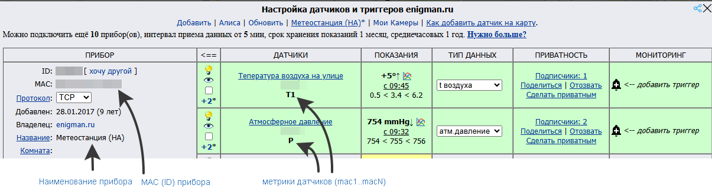
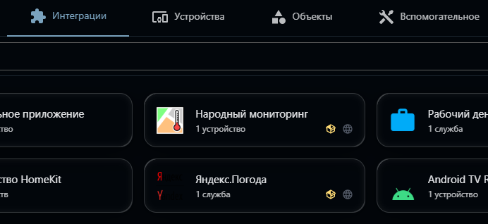
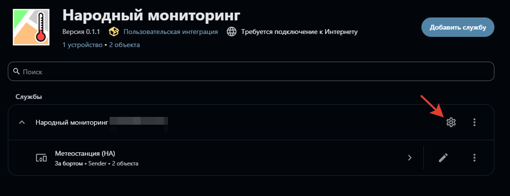
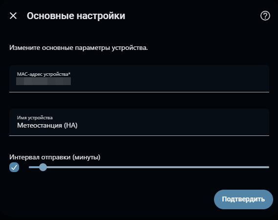
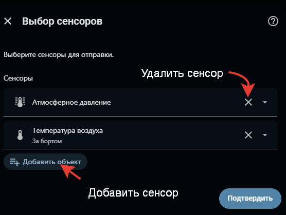
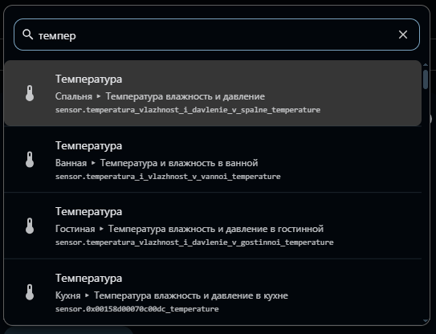
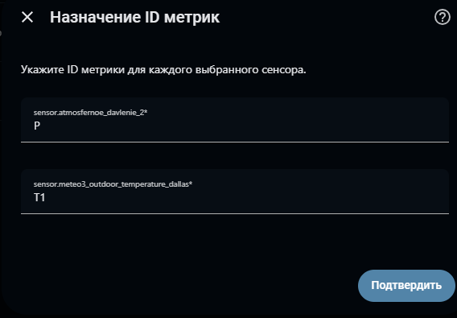
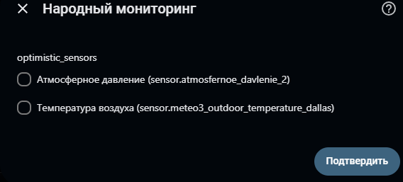

# narodmon_sender
Интеграция системы домашней автоматизации Home Assistant для передачи показания сенсоров в сервис "Народный мониторинг"

В Narodmon sender реализована отправка числовых показаний сенсоров Home Assistant в сервис [Народный мониторинг](https://narodmon.ru/about)

## Возможности
1. Отправка показаний сенсоров для одного или нескольких вируальных устройств Народного мониторинга
2. Автоматическая отправка показаний сенсоров с заданным интервалом или через вызов сервиса Home Assistant вручную или из автоматизации/скрипта
3. Отправка только новых показаний сенсоров по метке времени `last_reported`, в том числе при неизменном значении сенсора
4. Режим optimistic для каждого сенсора: текущее валидное значение сенсора будет передано в Народный мониторинг без проверки метки времени

## Установка

### Способ 1: Установка через HACS (рекомендуемый)

1. Убедитесь, что в вашем Home Assistant установлен HACS.
2. Откройте HACS. Нажмите на три точки в правом верхнем углу и выберите *Пользовательские репозитории*.
3. В поле *Репозиторий* введите URL: [https://github.com/enigmanel/narodmon_sender](https://github.com/enigmanel/narodmon_sender), в выпадающем списке *Категория* выберите *Интеграция*, нажмите *Добавить*
4. В главном окне HACS найдите в списке интеграцию «Народный мониторинг» и нажмите Загрузить.

После завершения загрузки перезапустите Home Assistant.

### Способ 2: Ручная установка 

1. Скачайте последний релиз с страницы [релизов](https://github.com/enigmanel/narodmon_sender/releases)
2. Распакуйте архив и скопируйте **папку narodmon_sender** в каталог **custom_components** вашей установки Home Assistant.
3. Если папки **custom_components** нет — создайте её в корне конфигурации.
4. Перезапустите Home Assistant.

## Настройка
Если вы уже являетесь участником проекта Народный мониторинг и хотите передавать показания для уже существующего в проекте прибора, вам понадобится MAC (ID) прибора в проекте (не MAC адрес физического устройства в вашей локальной сети) и mac1..macN - уникальные метрики датчиков подключенных к прибору.



Если вы еще не являетесь участником проекта, до начала настройки интеграции вам необходимо зарегистрироваться в сервисе Народного мониторинга, придумать MAC для вашего устройства (см. требования к mac в [документации проекта - раздел "Поле MAC (ID)"](https://narodmon.ru/devdoc)), а так же id для метрик датчиков  (см. [документацию - раздел "Поля mac1..macN"](https://narodmon.ru/devdoc))

1. Перейдите в «Настройки» → «Устройства и сервисы».
2. Нажмите «Добавить интеграцию» и выберите «Народный мониторинг».
3. Введите MAC-адрес вашего виртуального устройства (зарегистрируйте его на сайте narodmon.ru). Название прибора и периодичность передачи показаний в минутах (0 - отправлять показания только при вызове сервиса вручную или из автоматизации/скрипта)
4. Выберите сенсоры, показания которых надо передавать в сервис.
5. Для выбранных сенсоров укажите их ID метрики (T1, H1, P1 и т.п.).
6. На шаге «Режим optimistic» отметьте сенсоры, которые нужно отправлять каждый раз. По умолчанию режим выключен для всех сенсоров. Его можно включить или выключить отдельно для каждого сенсора через настройки интеграции.

Для изменения настроек перейдите в раздел *Настройки* -> *Устройства и службы* -> плитка *Народный мониторинг" -> Народный мониторинг *ваш MAC устройства* -> кнопка с шестеренкой. 



Запуск редактирования прибора



На этой странице настроек вводится MAC (ID) прибора в Народном мониторинге, название прибора (так он будет отображаться в Народном мониторинге и HA), интервал отправки показаний приборов (0 - отправлять показания только при вызове сервиса вручную или из автоматизации/скрипта)



На этой странице выбираются приборы, чьи показания будут отправляться. Используется стандартный механизм выбора прибора с возможностью поиска. Из этого же списка прибор можно удалить

 

Страница назначения метрик (id) датчиков (mac1..macN в терминологии проекта Народный мониторинг). 
Для выбранных на предыдущем этапе приборов назначаются id датчиков



Страница управления оптимистичным режимом. Режим назначается для каждого сенсора в отдельности. По умолчанию оптимистичный режим отключен.



## Использование

В обычном режиме сравнивается штамп времеми последнего обновления сенсора — `last_reported` (см. так же раздел "Возможные проблемы"). Если прибор повторно сообщил то же значение, показания будут отправлены в Народный мониторингн. В пакет передачи данных для Народного мониторинга включается штамп времени обновления сенсора. Сравнение сохраняет доли секунды, хотя формат пакета использует целые секунды.

В режиме optimistic текущее показание отправляется без сравнения временных меток, а в пакет включается время отправки пакета. 

Проверка значений действует в обоих режимах: отсутствующие, нечисловые, бесконечные значения и значения вне допустимого диапазона пропускаются. Настройка применяется и к автоматической отправке, и к сервису `narodmon_sender.send_data`.

1. Если на первом шаге настройки виртуального устройства был задан интервал передачи показаний, показания сенсоров будут предаваться автоматически с заданным интервалом. Установите интервал равный 0 для отключения этой возможности.

2. Интеграция предоставляет сервис `narodmon_sender.send_data`, который можно вызывать вручную, из автоматизации или скрипта.

### Пример автоматизации (передача показаний каждые 7 минут)

```yaml
automation:
  - alias: "Отправка в Народный мониторинг"
    trigger:
      - platform: time_pattern
        minutes: "/7"
    action:
      - service: narodmon_sender.send_data
        data:
          device_id: XXXXXXXXXXXXXX
```
Интеграция предоставляет два сенсора:
* Последняя отправка - хранит дату и время последнего отправленного пакета и включает такие атрибуты как:
    * Last packet - содержимое последнего отправленного пакета
    * Last response - ответ сервера на отправленный пакет
    * Last sent timestamps - содержит метрики датчиков и метки `last_reported` последних успешно отправленных показаний. Используется для предотвращения повторной передачи одного и того же отчёта в обычном режиме.
* Статус задачи - отображает статус задачи автоматической отправки показаний сенсоров. Обновляется 1 раз в 30 секунд

## Возможные проблемы

ESPHome может подавлять передачу в Home Assistant повторояющихся значений сенсора, из-за чего штампы времени у сенсоров в Home Assistant не обновляются, а их актуальные показания не передаются в Народный мониторинг. Для отключения такого поведения в yaml конфигурацию сенсора в ESPHome необходимо добавить переменную `force_update: true` [подробне](https://esphome.io/components/sensor/#base-sensor-configuration)

Иногда проще удалить прибор и настроить его заново, чем бороться с глюками... 
